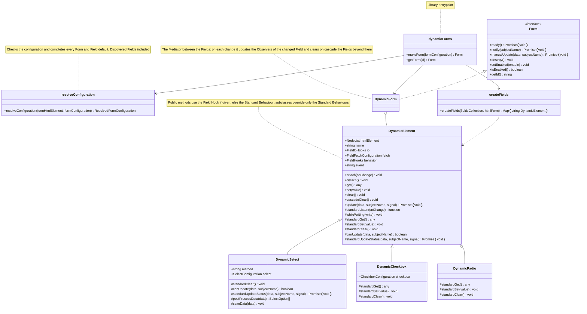

# Architecture
The UML class diagram of the library, to help you find your way in `src`. It shows the public members (`+`) and the members the Field kinds override (`#`); private members are left out, and so are types, for space reasons. The diagram is created using Mermaid, which places elements automatically.

Users only see `makeForm`, `getForm` and the `Form` interface: the classes are internal, and `DynamicForm` keeps its state in ES private fields.

