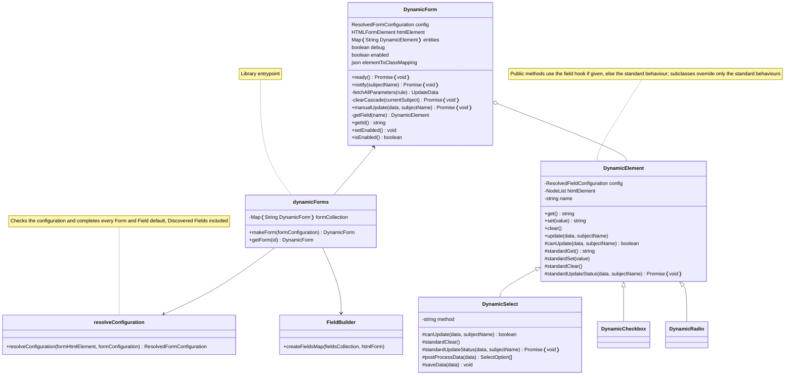

# Contribute
Help me develop DynamicForms!

Remember to work on `src/*.ts` files, and test them building the bundle and importing it (`import { makeForm } from '@dist/dynamic-forms.es.js';` for prod build, `import { makeForm } from '@';` for dev mode).

Useful commands:

- `npm run dev` - Start Vite server for local development
- `npm run build` - Build DynamicForms library in `dist` folder
- `npm test` - Run the test suite once
- `npm run test:watch` - Run the test suite in watch mode
- `npm run coverage` - Run the test suite with a coverage report in `coverage` folder
- `npm run typecheck` - Check types of sources and tests

## Tests
Tests live in the `tests` folder and run with [Vitest](https://vitest.dev) in a [jsdom](https://github.com/jsdom/jsdom) environment, which simulates the browser DOM inside Node.

- Test through the public API (`makeForm`, `getForm` and the returned `DynamicForm`) on a real html form mounted with `mountForm` (see `tests/helpers.ts`)
- Never call the network: stub remote calls with `stubFetch`
- Known bugs are tracked with `it.fails` tests describing the expected behavior: fixing the bug makes them fail, so turn them into plain `it` tests

The CI runs typecheck and tests on every push and pull request on `main`, and before publishing a release.

Please, update also the documentation if you change anything.

**Thank you very much for your support ❤**

## Disclaimer
DynamicForms is build considered some use-cases I faced in my career.

It is a very generic library but there may be other use cases which I didn't account for. In this case please let me know, we can work together in implementing new features.

## Issues/Suggestions
If you have trouble using DynamicForms open an issue, I'll be glad to help you. Suggestions are also welcome!

It will be useful if you pass me some code to try: you can use tools like CodePen, PasteBin etc.

# Project Structure
Here is the UML Class Diagram to help you understand the project structure. Types are not specified for space reasons: the diagram is created using Mermaid which places elements automatically.

